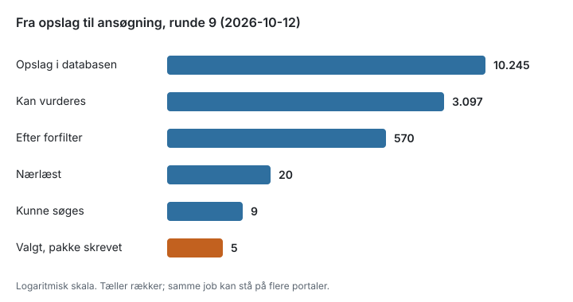
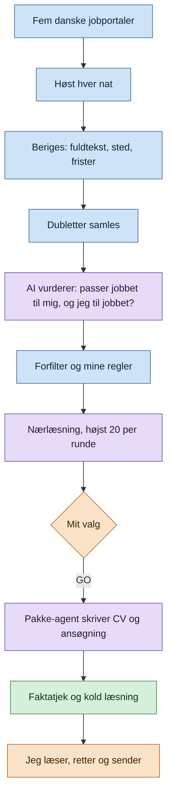
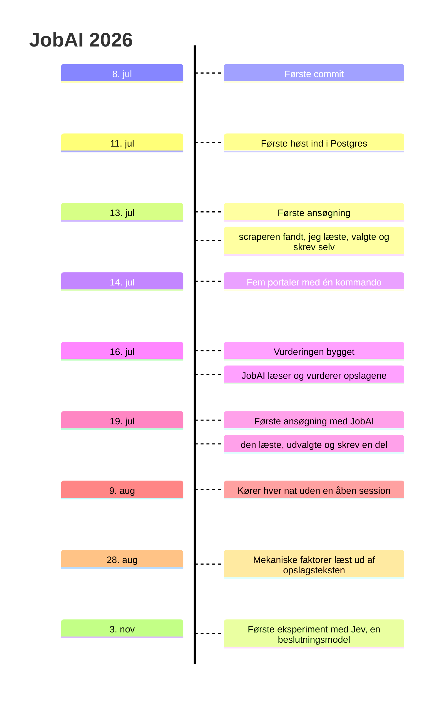

# JobAI: En jobsøgning, hvor maskinen forbereder og mennesket beslutter

Der kommer omkring 100 nye jobopslag om dagen i de portaler, jeg følger. Det kan én
person ikke læse ordentligt. Derfor byggede jeg JobAI: et system, der høster opslagene
hver nat, sorterer dem og lægger en håndfuld frem, som jeg kan tage stilling til.

Dette repo forklarer, hvordan det virker, og hvorfor det er bygget sådan. Koden ligger i
et privat repo; her er tankerne, tallene og erfaringerne.

> Vil du have den tekniske version (arkitektur, datamodel, designregler)? Se [Teknisk forklaring](tech.md).
> Hvad jeg undersøger lige nu? Se [Eksperimenter](experiments.md).

## Hvad det sparer

Før skulle jeg selv scanne hvert eneste opslag. Nu høster og sorterer maskinen dem hver nat,
og omkring 17 om dagen er relevante til vurdering. Af dem får jeg en håndfuld om ugen, der
kan søges. For hvert job, jeg vælger, får jeg et færdigt CV
og en ansøgning, der har været igennem faktatjek. Min tid går nu til at vælge og til at vurdere formuleringerne.

| Målt                               | Før, manuelt (juli) | Nu (sep-okt 2026)                                  |
| ---------------------------------- | ------------------- | -------------------------------------------------- |
| Min aktive tid per ansøgningspakke | ca. 8 timer         | median ca. 32 minutter (målt over 10 pakker)       |
| Nærlæste opslag                    | 7 om dagen          | 20 per ugentlig runde, udvalgt af ca. 100 om dagen |

Begge tider er målt i mine arbejdslogs. Kilder og målemetode: [stats/SOURCES.md](stats/SOURCES.md).

| # | Før: mig | Nu |
|---|---|---|
| 1 | Scanne alt, der kom ind | Høst hver nat |
| 2 | Sortere senior, stak og år fra | Forfilter og regler |
| 3 | Nærlæse og afgøre | Live-læsning, højst 20 per runde |
| 4 | Vælge | Mig: GO per job |
| 5 | CV: vælge projekter og vinkle | Pakke-agent fra faktalaget |
| 6 | Skrive ansøgningen | Pakke-agent fra faktalaget |
| 7 | Kontrollere | Faktatjek og kold læsning |
| 8 | Læse, rette, sende | Mig |

## Tragten: Fra 10.245 opslag til 5 ansøgningspakker

Hvert trin skærer fra. Maskinen gør det grove arbejde; de sidste trin er mine.

## Sådan hænger det sammen

Blå: maskinen. Lilla: AI. Orange: mig. Grøn: kontrol.

## Claude kører 24/7 på mit homelab

På mit eget homelab kører Claude døgnet rundt, og min laptop og mine andre services kan sende den opgaver. JobAI kører også selv på homelabbet og sender sin AI-del til Claude om natten. Laptoppen er
ikke med i det.

**Claude arbejder, mens jeg sover, og om morgenen ligger dommene klar.**

## Hvor mennesket beslutter

| Trin | Hvem |
|---|---|
| Høst, berigelse, dubletter | Maskinen |
| Vurdering og forfilter | Maskinen, efter regler jeg har godkendt |
| Hvilke job der søges | Mig: et GO per job |
| CV og ansøgning | Agent, kun fra et faktalag, jeg har godkendt |
| Kontrol | To agenter, der kun ser pakken |
| Læse, rette, sende | Mig |

Hver regel for ansøgningerne har min dom og en dato. Forslag fra AI'en, som jeg ikke har
godkendt, står åbne og bliver ikke brugt.

### Afsendelsen er mit valg

Hele kæden kunne køre uden mig. JobAI finder opslagene, en runde-agent udvælger dem, og en
pakke-agent skriver CV og ansøgning. En AI-session kan også åbne en browser, udfylde
ansøgningsformularen og sende den. Det sidste skridt har jeg bevidst valgt fra: det, der
sendes med mit navn på, læser og sender jeg selv.

## Kontrollen fanger det, AI'en finder på

Hver ansøgningspakke får to uafhængige kontroller, før jeg ser den: et fjendtligt
faktatjek og en kold læsning, som en rekrutter ville læse den. I runde 9 fangede
faktatjekket to påstande, som skriveagenten havde opdigtet. De blev rettet, før pakkerne
nåede mig.

Systemet er bygget ud fra, at en sprogmodel kan tage fejl. Derfor må intet stå i en
ansøgning, som ikke har en kilde.

## Fra idé til natlig drift

