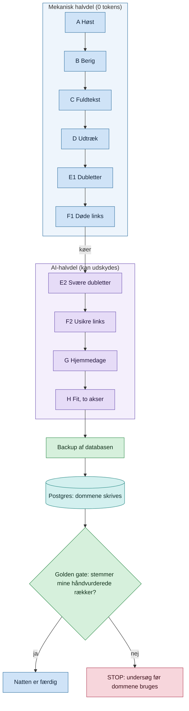
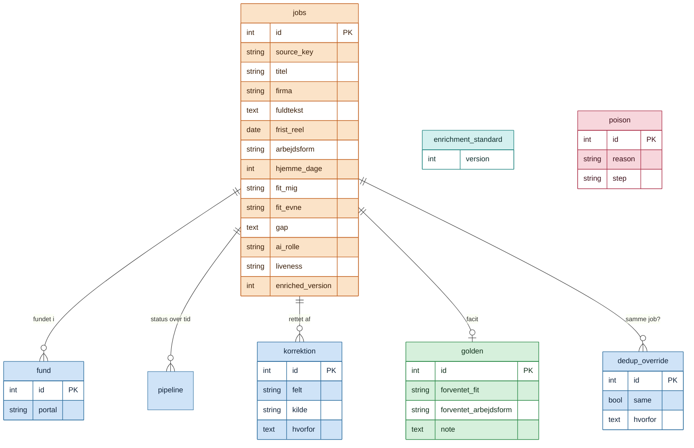
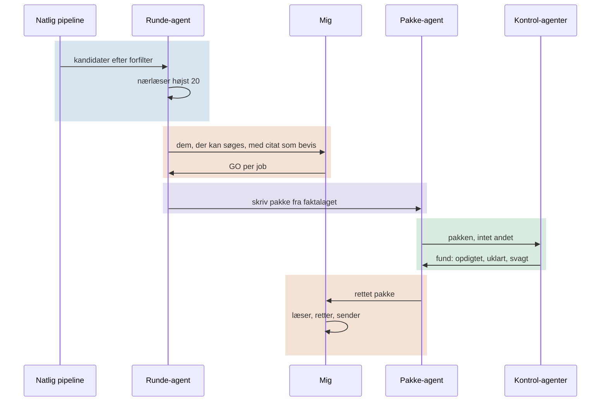

# Teknisk forklaring

Den tekniske side af [README](README.md): hvordan pipelinen er delt op, hvordan data ser ud,
og hvilke regler der er bygget ind efter fejl.

## To halvdele: Mekanisk og AI

Pipelinen har otte trin, A til H, delt i to. Den mekaniske halvdel bruger ingen tokens og
kører altid, også i en uge, hvor AI-budgettet er brugt op. AI-halvdelen kan udskydes uden at
høsten stopper.

### Hvad betyder mekanisk

Mekanisk er deterministisk kode uden sprogmodel: almindelig Python, HTTP-kald, parsing,
regex, SQL og faste regler. Samme input giver samme output, og det koster ingen tokens.
AI-halvdelen er det modsatte: en sprogmodel læser teksten og afgør noget, der kræver
forståelse.

| Trin | Mekanisk betyder her |
|---|---|
| A Høst | HTTP-kald til portalernes sider og API'er; felter parses ud |
| B Berig | Postnummer-opslag og geokodning; frister parses fra datoformater |
| C Fuldtekst | Strukturerede data (ld+json), DOM-parser, headless browser hvor JavaScript kræves |
| D Udtræk | Regex: reel frist, samtaledato, "løbende", AI-værktøjer, kodesignal |
| E1 Dubletter | Normaliserede titler og firmanavne sammenlignes fuzzy på tværs af portaler |
| F1 Døde links | HTTP-status og kendt "udløbet"-tekst; kun sikkert bevis tæller |

Grænsen går, hvor en regel ikke kan afgøre det. Næsten ens opslag, som reglerne ikke kan
skille ad, går til E2. Et link, der hverken er klart dødt eller klart levende, går til F2.

| Trin | Hvad | Halvdel |
|---|---|---|
| A | Høst fra fem portaler | Mekanisk |
| B | Berigelse: sted, arbejdsform, frist | Mekanisk |
| C | Fuldtekst: ATS-lag og headless browser | Mekanisk |
| D | Udtræk: reel frist, samtaledato, kodesignal | Mekanisk |
| E1 | Dubletter på tværs af portaler | Mekanisk |
| F1 | Er linket dødt? Kun sikre tilfælde | Mekanisk |
| E2 | Dubletter, de svære par | AI |
| F2 | Usikre links afgøres | AI |
| G | Hjemmearbejdsdage med citat som bevis | AI |
| H | To fit-akser, ét kald per række | AI |

Python bygger køerne og skriver dommene tilbage. AI'en bliver spurgt via en lille
dommer-tjeneste, der ikke kender databasen. JobAI spørger; den hoster ikke selv en model.
Tjenesten kan skiftes ud med en lokal model uden ændringer i JobAI.

## Datamodel

Kernen er `jobs`. De øvrige tabeller er spor: hvor et job blev fundet, hvem der rettede
hvad, og hvilke svar der er facit.

Udvalgte felter vist; `jobs` har omkring 60 kolonner.

**To fit-akser** i stedet for én score: `fit_mig` (passer jobbet til mig?) og `fit_evne`
(kan jeg levere det nu?), plus `gap` (hvad mangler, og kan det lukkes?). Et job kan være
drømmen og for svært, eller nemt og uinteressant. Én samlet score skjuler forskellen.

**`enrichment_standard`** holder styr på datastandarden. Når en ny kolonne kræver
genberigelse, hæves versionen i samme migration, og alle rækker under den står synligt som
forældede. Efterslæb kan ikke opstå i det skjulte.

**`poison`** er listen over opslag, som AI'en har nægtet at behandle af sikkerhedshensyn.
Sådan en afvisning kunne låse en hel session, og nye sessioner, der læste opslaget eller bare
en log, der citerede det, gik også i stå. Opslaget behandles derfor som radioaktivt: rækken
og alt, der citerer den, slettes, og `poison` husker kun, hvem det var, så det aldrig høstes
igen. Tabellen har bevidst ingen kolonne til titel, tekst eller citat, for en tabel, der
citerer opslaget, ville selv være giftig.

## Mennesket i loopet

Blå: maskinen. Orange: mig. Lilla: AI skriver. Grøn: kontrol.

## Fra fakta til ansøgning

En ansøgning bygges af fem slags kilder, og en påstand uden kilde må ikke stå i den.

| Kilde | Hvad den giver |
|---|---|
| Faktaark (27) | Ét per projekt, job og emne. Hver påstand har en kilde og en status: artefakt, egne noter, andres ord eller min udtalelse |
| Sendte pakker | Faste CV-blokke, der allerede er gennemarbejdet og sendt, kopieres ordret |
| CV- og ansøgningsguide | Reglerne: CV i otte sektioner, ansøgningen bygget som dem, mig, os |
| Interview med mig | Hvorfor netop dem, og hvad jeg vil bidrage med, i mine egne ord |
| Research | Virksomheden, dens mission og stak |

Bagefter kommer kontrollen. En faktatjek-agent ser kun pakken og faktaarkene og giver hver
påstand en dom: bevist, forkert eller ubevist. En kold læser læser pakken, som en rekrutterer
ville. Først derefter ser jeg den.

**Næste skridt: CV-træet.** Hver CV-blok får sin egen fil med varianter per type job og et
kildestempel på hvert tal. Det er under opbygning og bruges ikke i drift endnu.

## Regler bygget ind efter fejl

| Regel | Hvorfor |
|---|---|
| Død = kun med positivt bevis | Et falsk "dødt" skjuler et levende job; den dyreste fejl |
| Backup før hver skrivning, facit-tjek efter | En dårlig AI-kørsel må aldrig ødelægge data |
| Hvert AI-trin har sin model låst | Trin H kørte tre nætter på en billigere model, uden at noget fejlede |
| Højst 20 nærlæsninger per runde | Runde 4 brugte et helt AI-budget |
| Et AI-trin, der fejler, stopper ikke høsten | Den mekaniske halvdel skal altid levere |
| En kørsel ender `ok`, `partial` eller `failed` | En stille fejl ligner en kørsel, der intet fandt |

## Drift

Hele pipelinen kører hver nat på mit eget homelab, uden at en session er åben. Høsten og
databasen kører i Kubernetes; AI-halvdelen starter bagefter fra en systemd-timer.

### Claude som 24/7-tjeneste

Claude Code kører på homelabbet døgnet rundt som en lille dommer-tjeneste. Når høsten er
færdig, sender JobAI AI-halvdelens opgaver dertil, og tjenesten kalder `claude -p` med et
JSON-skema for hver række. Et svar, der ikke passer til skemaet, lander på en fejlliste og
skrives ikke ind. Om morgenen ligger dommene i databasen, og golden gate har sammenlignet dem med rækker, jeg
selv har vurderet. Afviger de, stopper natten med en besked om at undersøge det.

Selve dommer-tjenesten tager kun JobAI's fire AI-trin. Claude på homelabbet er ikke bundet til
JobAI: min laptop og mine andre services kan sende den andre opgaver over SSH, og de kører på homelabbet, ikke på
laptoppen.

### Hvornår AI-halvdelen starter

AI-halvdelen starter, når høsten er færdig, og ikke på et fast klokkeslæt: en langsom nat
ville ellers vurdere en halvfyldt kø.
